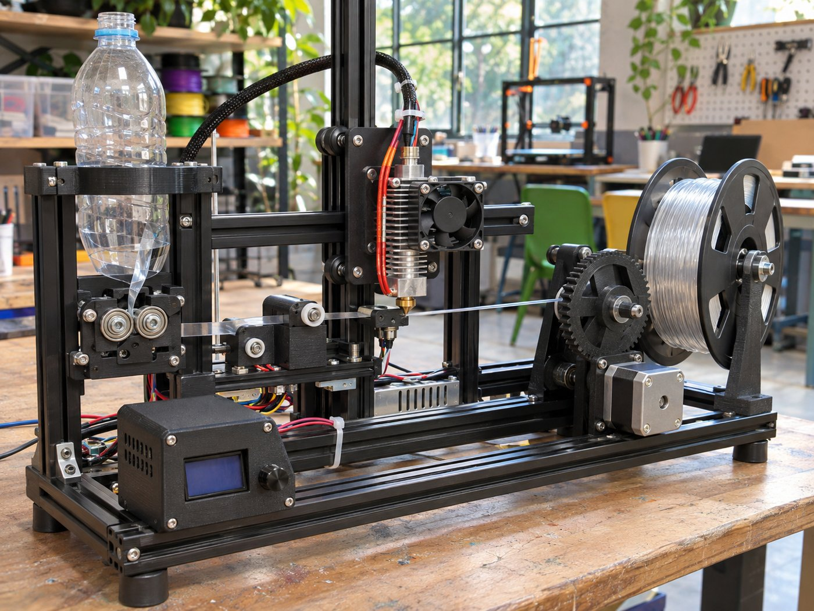

# Recicladora de botellas PET a filamento · Rincón Clubhouse Explora

Construí en el **Rincón Clubhouse Explora** una máquina que convierte botellas de plástico PET en **filamento para impresión 3D**. Usé las piezas de una impresora Ender-3 y el diseño abierto **Recreator 3D MK5Kit**. En este repositorio documento cómo lo hice, qué dificultades tuve y lo que me hubiera gustado saber antes, para que otra persona pueda construir la suya con menos tropiezos.

> **Sobre las imágenes:** al momento de crear este repositorio no tenía a mano las fotos reales del montaje. Las imágenes de la carpeta [`imagenes/`](imagenes/) son **imágenes de referencia generadas con IA**, no fotos de mi máquina. Las reemplazaré por fotos reales más adelante (ver [Issue abierto](https://github.com/skevin507/recicladora-pet-rincon/issues)).

*Imagen de referencia generada con IA. No es una foto de la máquina real.*

## Descripción

La máquina hace **pultrusión**: corta una botella en una tira larga y la jala a través de una boquilla caliente. La tira se ablanda, se dobla sobre sí misma y sale como filamento de 1,75 mm que se enrolla en un carrete. No derrite el plástico: lo ablanda a unos 210 °C y le da forma.

Partes principales:

- **Cortador de botellas:** dos rodamientos afilados que cortan la botella en tira.
- **Hotend modificado:** la boquilla de la Ender-3, con el orificio agrandado a 1,7 mm.
- **Bobinador:** un motor paso a paso con engranajes que jala la tira y enrolla el filamento.
- **Electrónica:** la fuente de 24 V, la placa principal y la pantalla de la misma Ender-3.
- **Estructura:** los perfiles de aluminio del eje Z y las piezas impresas en 3D.

## Problema o necesidad

- Las botellas PET terminan en la basura o en la naturaleza, aunque son un material útil para imprimir.
- El filamento cuesta dinero, y en un espacio maker se consume mucho.
- Muchas impresoras Ender-3 quedan sin usar o dañadas. Este proyecto les da una segunda vida.
- **La documentación que seguí no dejaba claro todo lo necesario**, sobre todo qué conectar y desconectar en la placa y cuántos tornillos hacían falta. Este repositorio busca llenar ese vacío.

## Público objetivo

- Jóvenes, mentores y mentoras de espacios maker como los Clubhouse.
- Docentes y escuelas que tengan una Ender-3 sin uso.
- Cualquier persona que quiera reciclar botellas en filamento y no sepa por dónde empezar.

## Origen

La idea nació en el Rincón Clubhouse Explora. Seguí el video de CNC Kitchen [«PET Bottle Recycling: Waste to 3D Printing Filament»](https://www.youtube.com/watch?v=1yIe1Pp_Nrg) y el diseño [Recreator 3D MK5Kit Ender3 Pultrusion Unit](https://www.printables.com/model/179820-recreator-3d-mk5kit-ender3-pultrusion-unit), de JRT3D, en Printables. **Imprimí todas las piezas con la impresora del Rincón.**

Al construirla me encontré con dos problemas que no esperaba:

1. **Las conexiones de la placa.** Ni el video ni las guías explicaban con claridad qué había que desconectar y qué conectar en la placa principal.
2. **Los tornillos.** Al principio entendí que bastaban los tornillos de la propia impresora. No fue así: tuve que comprar tornillos aparte, y gasté **entre 80 y 95 dólares** en todos los necesarios.

## Estado actual

- ✅ Máquina construida en el Rincón, siguiendo los pasos del video.
- ✅ Todas las piezas impresas con la impresora del Rincón.
- ✅ Documentados los pasos, las dificultades y el presupuesto de tornillos.
- ⏳ Faltan las fotos reales del montaje (por ahora hay imágenes de referencia).
- ⏳ Falta la lista exacta de tornillos (medida y cantidad de cada uno) y un diagrama de conexiones de la placa.

## Cómo comenzar

1. Lee la [guía de construcción](docs/guia-de-construccion.md): los pasos en orden, con mis notas.
2. Revisa [tornillos y presupuesto](docs/tornillos-y-presupuesto.md) **antes de empezar**, para comprar todo de una vez.
3. Revisa [conexiones de la placa](docs/conexiones-de-la-placa.md): qué se usa de la Ender-3 y qué no.

**Necesitas:** una Ender-3 (aunque no funcione como impresora), otra impresora para imprimir las piezas, tornillos M4 y tuercas en T, botellas PET limpias, una pistola de calor y unas 2 horas por botella grande.

## Próximos pasos

- Subir fotos reales de cada etapa del montaje.
- Hacer la tabla exacta de tornillos y un diagrama de conexiones de la placa.
- Medir cuánto filamento sale de las botellas que más se usan aquí.
- Usar la máquina en un taller del Rincón, para que los jóvenes reciclen botellas e impriman con su propio filamento.

¿Quieres ayudar? Lee [CONTRIBUTING.md](CONTRIBUTING.md).

## Uso de inteligencia artificial

- Usé un asistente de IA (Claude) para transcribir y resumir el video de CNC Kitchen, ordenar los pasos y redactar los borradores de esta documentación a partir de lo que yo le conté de mi construcción.
- Usé ChatGPT para generar las **imágenes de referencia**, porque no tenía las fotos reales a mano. Están marcadas como tales en cada lugar donde aparecen.
- Las dificultades, el presupuesto y la experiencia de construcción son míos. Revisé que la IA no inventara pasos, medidas ni resultados. Lo que no sé con certeza, como la cantidad exacta de cada tornillo, queda marcado como pendiente.

## Créditos y licencia

- Diseño de la máquina: **Recreator 3D MK5Kit**, de [JRT3D (Joshua Taylor)](https://www.printables.com/model/179820-recreator-3d-mk5kit-ender3-pultrusion-unit) · [recreator3d.com](http://recreator3d.com/). Licencia CC BY-NC-SA 4.0.
- Video de referencia: [CNC Kitchen](https://www.youtube.com/watch?v=1yIe1Pp_Nrg).
- Esta documentación se comparte con la misma licencia, [CC BY-NC-SA 4.0](https://creativecommons.org/licenses/by-nc-sa/4.0/deed.es): puedes usarla y adaptarla citando la fuente, sin fines comerciales y compartiendo tus cambios igual.

Proyecto de Kevin Fernández ([@skevin507](https://github.com/skevin507)) · Reto 6 del curso SINT-741, Activadores de Comunidades de Práctica.
