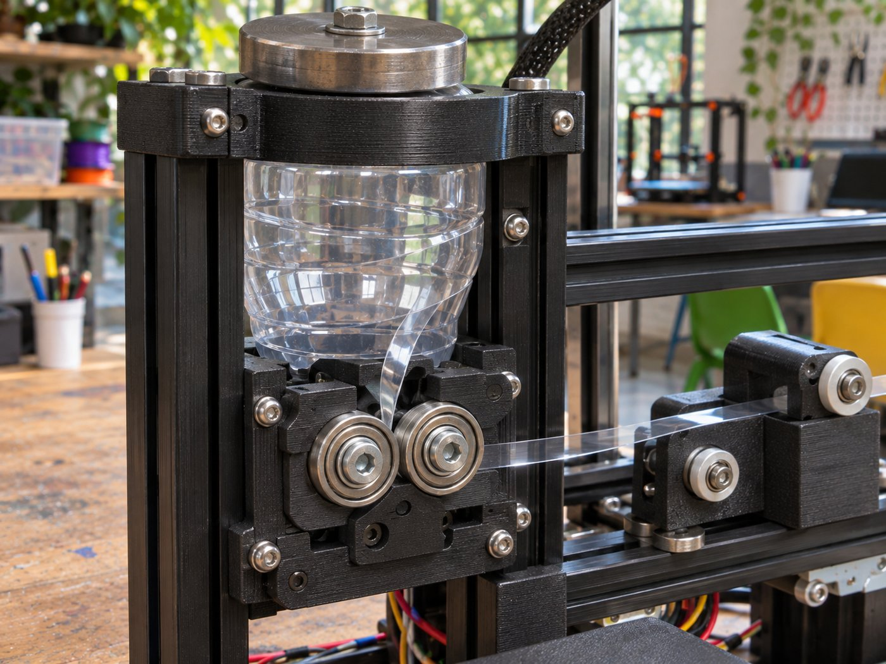

# Guía de construcción

Estos son los pasos que seguí, en el mismo orden del video de CNC Kitchen. Al lado de cada paso indico el minuto del [video](https://www.youtube.com/watch?v=1yIe1Pp_Nrg) donde aparece. Mis notas van marcadas con **Mi nota**.

> ⚠️ **Seguridad:** la máquina se conecta a la red eléctrica (110–220 V) y el hotend supera los 200 °C. Haz las conexiones con la máquina desenchufada y, si eres joven, con un mentor o mentora presente.

## 1. Imprimir las piezas (02:31)

- Descarga los archivos del [Recreator 3D MK5Kit](https://www.printables.com/model/179820-recreator-3d-mk5kit-ender3-pultrusion-unit), en Printables.
- En el video, casi todo se imprime en **PLA**. El **soporte del hotend** y los **engranajes** van en **PETG**, porque se calientan más o sufren más esfuerzo.
- El cortador de botellas es un **proyecto aparte** que también hay que descargar e imprimir.
- En el video, imprimir todo, incluida la caja de la electrónica, tomó cerca de **un carrete y medio y dos días** de impresión continua.

**Mi nota:** imprimí todas las piezas con la impresora del Rincón Clubhouse Explora. Conviene planificar la impresión por lotes, porque son muchas piezas.

## 2. Desarmar la Ender-3 (03:00)

Se aprovechan estas partes:

- el **hotend**;
- la **fuente de 24 V**;
- los **perfiles de aluminio del eje Z**, que forman la estructura;
- la **pantalla LCD**, para controlar la máquina;
- la **placa principal**;
- los **rodamientos de las ruedas**, que se usan en el cortador y en el bobinador;
- el **carro del eje X** y la cubierta metálica del hotend;
- un **motor paso a paso**.

No hace falta desarmarla toda, pero si quieres reutilizar lo máximo posible, puedes hacerlo.

## 3. Armar el cortador de botellas (03:44)

*Imagen de referencia generada con IA, no es una foto de mi máquina.*

- Usa dos rodamientos de las ruedas de la Ender-3 que giran uno contra el otro y cortan la botella en una tira.
- Los bordes de esos rodamientos son redondeados, así que hay que **lijar o esmerilar una cara de cada uno** hasta que el borde quede afilado.
- Se montan con las caras afiladas enfrentadas.
- El diseño original usa monedas como protección contra el desgaste, y existen variantes de la comunidad para monedas de otros países.

## 4. Modificar el hotend (04:32)

- **Boquilla:** se agranda el orificio de 0,4 mm con una broca de **1,7 mm**. Comprueba el diámetro con un trozo de filamento de 1,75 mm.
- **Disipador:** se ensancha la entrada para que la tira pase suave de ancha a delgada. En el video se usa un avellanador de 60°.
- **Al rearmar se deja fuera el *heat break*** (la pieza que normalmente separa el bloque calefactor del disipador). Es a propósito: así hay un tramo más largo caliente que ablanda la tira de forma pareja.
- El hotend modificado se monta en el carro del eje X original, con su cubierta metálica y su ventilador, y todo va sobre el soporte de PETG.

## 5. Armar la estructura y la electrónica (05:40)

- La estructura se arma con los perfiles del eje Z, unidos con las piezas impresas.
- Sobre ella se monta la fuente; luego la placa en su soporte, el enchufe de corriente y la pantalla.
- **Aquí aparecen los tornillos que faltan.** Revisa [tornillos y presupuesto](tornillos-y-presupuesto.md) antes de llegar a este paso.
- Las conexiones se explican en [conexiones de la placa](conexiones-de-la-placa.md).

**Mi nota:** este fue el paso más difícil. No tenía claro qué cables desconectar y cuáles conectar en la placa, y me quedé sin tornillos a mitad del armado.

## 6. Montar el hotend y el bobinador

- Se monta el hotend y su ventilador en los rieles.
- El motor paso a paso va en su soporte, con su engranaje.
- La reducción usa una rueda sobrante de la Ender-3 como bloque de rodamiento, encajada a presión en su soporte.
- Por último se monta el portacarrete, el cortador de botellas y las piezas de la caja inferior.

## 7. Probar

- La máquina **no necesita un firmware especial**: usa el de la Ender-3.
- Es normal que la pantalla muestre una **temperatura negativa en la cama**, porque su termistor no se conecta.
- Para empezar a hacer filamento, sigue [preparar la botella y hacer filamento](preparar-botella-y-uso.md).
