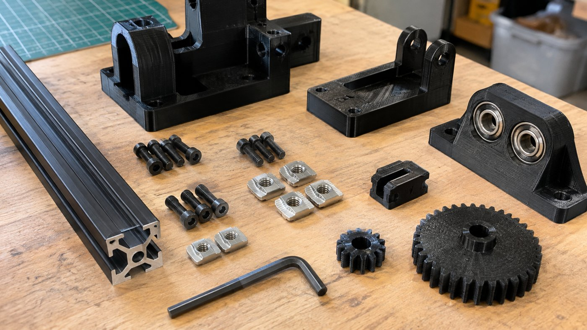

# Tornillos y presupuesto

**Lo más importante que aprendí:** los tornillos de la Ender-3 **no alcanzan** para armar la recicladora. Al principio pensé que con los de la impresora bastaba, y tuve que parar el armado para comprar más.

*Imagen de referencia generada con IA, no es una foto de mis piezas.*

## Lo que se sabe

- El propio video lo admite en el minuto 05:40: las piezas que se rescatan de la Ender-3 no son suficientes. En la construcción del video faltaron unos **40 tornillos M4 × 8 mm** y **40 tuercas en T**, y además **otros tornillos** que no detalla.
- La página del diseño en Printables enlaza unas notas de construcción con lista de materiales en un documento aparte. En las guías que seguí, el video y la página del modelo, **no encontré con claridad cuántos tornillos hacían falta de cada medida**.

## Lo que gasté

| Concepto | Monto |
|---|---|
| Todos los tornillos y tuercas necesarios | **Entre 80 y 95 dólares** |

Lo demás salió de la Ender-3 y de las piezas que imprimí en el Rincón.

## Lista exacta de tornillos (pendiente)

Esta tabla está por completar. Solo lleva lo que esté comprobado en la máquina, no estimaciones.

| Medida | Para qué parte | Cantidad | ¿Viene en la Ender-3? |
|---|---|---|---|
| M4 × 8 mm | Unión de perfiles y piezas | ~40 (según el video) | No alcanza |
| Tuerca en T para M4 | Perfiles de aluminio | ~40 (según el video) | No alcanza |
| *(por completar)* | | | |

Si construiste una y tienes la lista, [abre un Issue](https://github.com/skevin507/recicladora-pet-rincon/issues) o un Pull Request.

## Consejo antes de empezar

1. Descarga las notas de construcción del diseño y revisa su lista de materiales.
2. Desarma la Ender-3 y **cuenta los tornillos que realmente tienes**, separados por medida.
3. Compra la diferencia **antes** de empezar a armar. Así no tienes que parar a mitad del proceso, como me pasó a mí.
